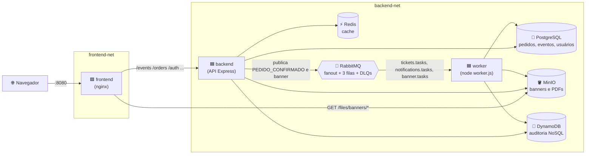
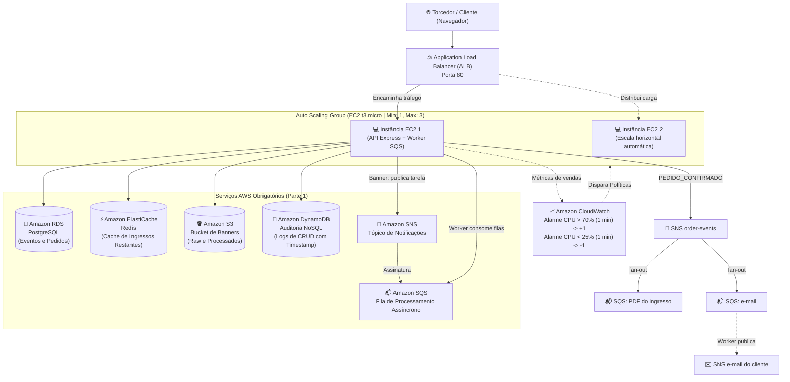

# Loja de Ingressos para Jogos de Futebol - Docker Compose

Trabalho Prático 2 da disciplina **Desenvolvimento de Software para Nuvem (UFC)**: implantação com **Docker e Docker Compose**, trocando os serviços gerenciados da AWS (Trabalho 1) por containers.  
**Professores:** Dr. Paulo A. L. Rego e Dr. Fernando Antonio Mota Trinta  

> O Trabalho 1 (AWS + Terraform) continua documentado no [Apêndice](#apêndice-trabalho-1-aws--terraform) e na pasta `infra/`.

---

## 🎯 Visão Geral

Plataforma para venda de ingressos de jogos de futebol com controle atômico de estoque, cache em memória, processamento assíncrono (banners, PDF e e-mail) e auditoria em banco NoSQL, tudo subindo com **um único comando**.

### Funcionalidades

- **Setores com preço próprio** (Arquibancada Norte e Sul, Cadeira Central, Camarote) escolhidos num **mapa clicável do estádio**.
- **Reserva temporária de 10 minutos** no checkout: os ingressos saem do estoque ao reservar e voltam sozinhos se a compra não for confirmada (cronômetro na tela).
- **Ingresso em PDF com QR code assinado**, gerado em segundo plano pelo worker e guardado de forma privada no MinIO (a API entrega o arquivo depois de validar o token).
- **E-mail de confirmação** com o link do ingresso, gerado pelo worker a partir de uma fila do RabbitMQ (gravado na caixa de saída local `/data/outbox`).
- **Meus ingressos**: cada torcedor vê só as próprias compras e baixa os PDFs.
- **Painel admin** (acesso apenas pelo endereço `/admin`): CRUD de jogos e setores, pedidos, auditoria (DynamoDB), status dos serviços e gerador de carga.

---

## 🏛️ Arquitetura (Trabalho 2)



**Fluxo de uma compra:** o navegador chama o nginx, que repassa a API; a API grava o pedido no PostgreSQL (UPDATE atômico do estoque), registra a ação no DynamoDB, invalida o cache no Redis e publica `PEDIDO_CONFIRMADO` no exchange fanout `order.events` do RabbitMQ. A mesma mensagem chega às filas `tickets.tasks` e `notifications.tasks`; o worker gera o PDF com QR code (salva em `tickets/` no MinIO, privado) e grava o e-mail. A API responde sem esperar nada disso.

## 📋 Conformidade com os Requisitos (Trabalho 2)

| Requisito | Tecnologia | Como foi implementado |
| :--- | :--- | :--- |
| **Banco relacional** (substitui RDS) | **PostgreSQL 16** em container | Serviço `postgres` com volume `pgdata`, healthcheck (`pg_isready`) e **sem porta publicada**. O esquema (`schema.sql`) é aplicado no boot da API, com *advisory lock* e carga inicial. Não existe fallback para arquivo: sem o banco a API não sobe. |
| **Armazenamento de objetos** (substitui S3) | **MinIO** em container | Serviço `minio` com volume `miniodata`. Bucket único: `banners/*` público (só leitura, via nginx) e `tickets/*` privado (a API entrega o PDF depois de validar o token). Bucket e política criados pela API no boot. |
| **Mensageria** (substitui SNS/SQS) | **RabbitMQ 3.13** em container | Exchange fanout `order.events` → filas `tickets.tasks` e `notifications.tasks`; fila `banner.tasks`; DLQs (`*.dlq`) via exchange `dlx`. Mensagens persistentes, confirmação do produtor, ack/nack e nova tentativa no worker. |
| **NoSQL** (mantido) | **DynamoDB** (DynamoDB Local em container, ou o da AWS) | Auditoria de todas as ações do CRUD. A API cria a tabela e o índice `by-time` no boot (`ensureTable`). Veja [DynamoDB](#dynamodb-local-ou-aws). |
| **Dockerfiles** | backend, worker e frontend | `backend/Dockerfile` (multi-stage, usuário não-root) é usado pela API **e** pelo worker; `frontend/Dockerfile` (nginx). |
| **Docker Compose** | `docker-compose.yml` | 8 serviços, 2 redes (`backend-net`, `frontend-net`), volumes nomeados, `depends_on` com `condition: service_healthy` e `restart: unless-stopped`. |
| **Cache** | Redis em container | Listagem de jogos e estoque (`events:list`), invalidado a cada compra. |

---

## 📂 Estrutura do Repositório

```text
├── backend/
│   ├── Dockerfile           # Imagem única da API e do worker (multi-stage, usuário não-root)
│   ├── server.js            # Ponto de entrada: sobe o Express (src/app.js) e inicializa os serviços
│   ├── worker.js            # Worker: consome as filas do RabbitMQ (banner, PDF, e-mail)
│   ├── schema.sql           # Esquema relacional (PostgreSQL) - fonte única
│   ├── test-api.test.js     # Testes automatizados da API e do Worker (Node test runner)
│   ├── package.json         # Dependências (Express, pg, amqplib, redis, sharp, SDK S3/DynamoDB)
│   └── src/                 # Arquitetura MVC, um módulo (pasta) por CRUD
│       ├── app.js           # Monta o Express: middlewares + rotas de cada módulo
│       ├── bootstrap.js     # Inicialização (Redis, PostgreSQL, RabbitMQ, MinIO, DynamoDB)
│       ├── config/          # Variáveis de ambiente e caminhos
│       ├── lib/             # Infra compartilhada: db (PostgreSQL), cache (Redis), storage (MinIO), queue (RabbitMQ), notifier (e-mail local)
│       ├── middlewares/     # auth (JWT/admin), upload (multer), errorHandler
│       └── modules/
│           ├── events/      # CRUD de jogos: model, controller, routes, validation
│           ├── orders/      # Compra (estoque atômico), listagem (admin) e "meus ingressos": model, controller, routes
│           ├── users/       # Cadastro e login de clientes: model, controller, routes, password
│           ├── auth/        # Login do administrador
│           ├── audit/       # Auditoria no DynamoDB: model, controller, routes
│           └── system/      # /health (healthcheck) e /stress (carga de CPU)
├── frontend/
│   ├── index.html           # Vitrine, login e checkout
│   ├── meus-ingressos.html / .js # Tela "Meus ingressos": pedidos do usuário logado
│   ├── admin.html / admin.js # Painel admin: CRUD, pedidos, auditoria, status dos serviços e teste de carga
│   ├── app.js               # Integração assíncrona da vitrine/checkout
│   ├── styles.css           # Estilização moderna e responsiva
│   ├── Dockerfile           # nginx + site estático
│   └── default.conf.template # nginx: proxy da API e dos banners (MinIO)
├── infra/                   # Trabalho 1 (AWS/Terraform), mantido como histórico
│   ├── main.tf              # Provisionamento completo em Terraform (ALB, ASG, RDS, Cache, S3, DynamoDB, SNS/SQS + DLQ)
│   ├── variables.tf         # Declaração de variáveis
│   ├── outputs.tf           # Saídas da infraestrutura (URL do ALB, endpoints dos bancos)
│   ├── user_data.sh.tpl     # Script de bootstrap automatizado para a EC2
│   ├── terraform.tfvars.example # Exemplo de configuração
│   └── README.md            # Documentação da infraestrutura e roteiro de gravação do vídeo
├── loadtest/
│   ├── k6-elasticidade.js   # Teste de carga da Parte 2 (k6), com relatório HTML
│   └── README.md            # Como rodar o k6 e o que mostrar no vídeo
├── docker-compose.yml       # Stack completa do Trabalho 2 (8 serviços)
├── docker-compose.dev.yml   # Override: publica as portas dos serviços em 127.0.0.1 (dev/testes)
├── .env.example             # Variáveis do Compose (senhas, bucket, DynamoDB)
└── README.md                # Este documento
```

### Padrão MVC por módulo

Cada recurso fica em sua pasta em `backend/src/modules/<recurso>/` com:

| Camada | Arquivo | Responsabilidade |
| :--- | :--- | :--- |
| **Model** | `*.model.js` | Acesso a dados (PostgreSQL). Sem conhecer HTTP. |
| **Controller** | `*.controller.js` | Valida a entrada e orquestra model + MinIO + cache + auditoria + fila; monta a resposta. |
| **Routes** | `*.routes.js` | Liga URL/verbo HTTP aos controllers e aplica os middlewares (admin, usuário, upload). |
| **View** | `frontend/` | Interface web que consome a API JSON. |

Para criar um novo CRUD, crie a pasta do módulo e registre suas rotas em `src/app.js`.

---


## 🐳 Executar com Docker Compose

Sobe tudo com um único comando: **PostgreSQL**, **RabbitMQ**, **MinIO** e **DynamoDB Local** (substituem RDS, SNS/SQS, S3 e o DynamoDB gerenciado), mais Redis, backend (API), worker e frontend (nginx).
Pré-requisitos: Docker e Docker Compose v2.

```bash
git clone <url-do-repositorio> && cd LojaArenaCastelao
cp .env.example .env          # troque as senhas e o JWT_SECRET
docker compose up --build -d
docker compose ps             # todos "healthy" (o worker e o frontend ficam "Up")
```

Acesse **http://localhost:8080** (loja) e **http://localhost:8080/admin** (painel, senha = `ADMIN_PASSWORD`).

| Serviço | Imagem | Rede | Observação |
|---|---|---|---|
| `postgres` | `postgres:16-alpine` | `backend-net` | volume `pgdata`; **sem porta publicada** no host |
| `dynamodb` | `amazon/dynamodb-local` | `backend-net` | volume `dynamodata`; a API cria a tabela e o índice no boot; **sem porta publicada** |
| `minio` | `chainguard/minio` | `backend-net`, `frontend-net` | volume `miniodata`; bucket `stadium-files` criado pela API no boot; console em http://localhost:9001 (usuário/senha do `.env`). O `minio/minio` saiu do Docker Hub, por isso a imagem da Chainguard |
| `rabbitmq` | `rabbitmq:3.13-management-alpine` | `backend-net` | volume `rabbitmqdata`; painel de gestão em http://localhost:15672 (usuário/senha do `.env`) |
| `redis` | `redis:7-alpine` | `backend-net` | cache |
| `backend` | `backend/Dockerfile` | `backend-net`, `frontend-net` | espera todos os serviços acima saudáveis; cria o esquema (`schema.sql`), os jogos iniciais, o bucket e a tabela no 1º boot |
| `worker` | mesma imagem do backend (`node worker.js`) | `backend-net` | consome as filas do RabbitMQ (PDF, e-mail, banner); espera os serviços e o backend saudáveis |
| `frontend` | `frontend/Dockerfile` (nginx) | `frontend-net` | serve o site e repassa a API para o `backend` e os banners para o MinIO; única porta publicada para o público: 8080 |

Comandos úteis:
```bash
docker compose logs -f backend worker                                  # logs
docker compose exec postgres sh -c 'psql -U $POSTGRES_USER -d $POSTGRES_DB -c "select * from orders;"'
curl -s localhost:8080/health                                          # status de cada serviço
docker compose down        # para os serviços, mantém os dados (volumes)
docker compose down -v     # para e APAGA os dados
```

Para rodar a API/testes fora do Docker, com os serviços em containers:
`docker compose -f docker-compose.yml -f docker-compose.dev.yml up -d postgres redis rabbitmq minio dynamodb` (publica 5432/6379/5672/9000/8000 só em 127.0.0.1).

**Filas (RabbitMQ):** a compra publica `PEDIDO_CONFIRMADO` no exchange fanout `order.events`, que entrega a mesma mensagem às filas `tickets.tasks` (PDF) e `notifications.tasks` (e-mail); `banner.tasks` redimensiona banners. Cada fila tem uma DLQ (`*.dlq`) para mensagens ilegíveis ou rejeitadas. Se o RabbitMQ cair e voltar, o worker se reinscreve sozinho.

**Arquivos (MinIO):** um bucket com dois prefixos. `banners/*` (original e miniatura) tem leitura anônima e o nginx o expõe em `/files/banners/` (só `GET`). `tickets/*` (PDF do ingresso) é privado: só a API lê do MinIO e entrega o PDF depois de validar o token do dono. O código usa o `@aws-sdk/client-s3` com `endpoint` e `forcePathStyle`, porque o MinIO fala o protocolo S3.

### DynamoDB: Local ou AWS

O DynamoDB guarda só a **auditoria** (tipo da ação, dados manipulados e horário). Cada item tem `pk = 'AUDIT'`, para entrar no índice global `by-time` (`pk` + `timestamp`) e permitir listar os registros mais recentes em ordem (um `Scan` não garante ordem). O painel admin lê esses registros em `/audit-logs`.

- **Padrão (Compose):** o container `dynamodb` (DynamoDB Local, mesma API do serviço da AWS). Não precisa de conta nem de credenciais reais; os dados persistem no volume `dynamodata`.
- **DynamoDB real na AWS:** no `.env`, deixe `DYNAMODB_ENDPOINT=` vazio e preencha `AWS_REGION`, `AWS_ACCESS_KEY_ID`, `AWS_SECRET_ACCESS_KEY` (e `AWS_SESSION_TOKEN` no AWS Academy, onde as credenciais expiram). A API cria a tabela `DYNAMODB_TABLE_NAME` sozinha. As credenciais ficam só no `.env`, que não vai para o repositório.

```bash
# conferir a auditoria direto no DynamoDB Local
docker compose exec backend node -e "
const {DynamoDBClient}=require('@aws-sdk/client-dynamodb');const {DynamoDBDocumentClient,ScanCommand}=require('@aws-sdk/lib-dynamodb');
DynamoDBDocumentClient.from(new DynamoDBClient({region:'us-east-1',endpoint:process.env.DYNAMODB_ENDPOINT}))
  .send(new ScanCommand({TableName:process.env.DYNAMODB_TABLE_NAME})).then(r=>console.log(r.Count,'itens'))"
```

---

## 📸 Evidências de funcionamento

> Capturas de tela da execução. Salve as imagens em `docs/prints/` com os nomes abaixo.

| # | O que mostrar | Como obter | Arquivo |
|---|---|---|---|
| 1 | Todos os serviços de pé e saudáveis | `docker compose ps` | `docs/prints/01-compose-ps.png` |
| 2 | Status de cada serviço na API | `curl -s localhost:8080/health` | `docs/prints/02-health.png` |
| 3 | Loja funcionando | http://localhost:8080 | `docs/prints/03-loja.png` |
| 4 | Tabelas e linhas no PostgreSQL | Beekeeper/psql: `select * from orders;` | `docs/prints/04-postgres.png` |
| 5 | Filas, exchange fanout e DLQs | http://localhost:15672 → *Queues* | `docs/prints/05-rabbitmq.png` |
| 6 | Objetos no bucket (`banners/` e `tickets/`) | http://localhost:9001 → *Object Browser* | `docs/prints/06-minio.png` |
| 7 | Auditoria vinda do DynamoDB | Painel admin → *Auditoria* | `docs/prints/07-auditoria.png` |
| 8 | PDF do ingresso após a compra | *Meus ingressos* → baixar | `docs/prints/08-ingresso-pdf.png` |


---

## 💻 Como Executar Localmente (sem containers para a aplicação)

### 1. Subir os serviços de apoio
O **PostgreSQL, o RabbitMQ e o MinIO são obrigatórios**: sem `DATABASE_URL`, `RABBITMQ_URL` e `MINIO_*` a API e o worker recusam subir (não existe mais modo em arquivo). O DynamoDB e o Redis são opcionais (sem `DYNAMODB_TABLE_NAME` a auditoria fica só em memória).
```bash
docker compose -f docker-compose.yml -f docker-compose.dev.yml up -d postgres redis rabbitmq minio dynamodb   # exige o .env da raiz
cd backend && cp .env.example .env   # ajuste DATABASE_URL, RABBITMQ_URL, MINIO_* com as senhas do .env da raiz
                                     # e, para o DynamoDB Local: DYNAMODB_TABLE_NAME=stadium-audit-logs e DYNAMODB_ENDPOINT=http://localhost:8000
export $(grep -v '^#' .env | xargs)  # ou: node --env-file=.env server.js
```

### 2. Rodar a API e o Worker
```bash
cd backend
npm install

# Em um terminal, inicie a API:
npm start

# Em outro terminal, inicie o Worker:
npm run worker
```

Acesse a interface no navegador em: `http://localhost:3000`

### 3. Rodar os Testes Automatizados
```bash
cd backend
npm test
```
*Executa 20 testes: rotas da API, healthcheck, autenticação, validações, upload só de imagens, compras concorrentes por setor (nunca vende acima do estoque), setores, reserva temporária (confirmação, cancelamento, expiração e limpeza pelo worker), PDF + e-mail via fan-out, "Meus ingressos" (cada usuário só vê os próprios), log de auditoria, processamento do Worker e fluxo do MinIO (banner público, PDF privado). Exigem PostgreSQL, RabbitMQ e MinIO reais (`DATABASE_URL`, `RABBITMQ_URL`, `MINIO_ENDPOINT`, `MINIO_ACCESS_KEY`, `MINIO_SECRET_KEY`) e rodam com `ADMIN_PASSWORD` vazio e sem `NODE_ENV=production` (a rota de admin fica aberta só nos testes). Não rode o worker do Compose ao mesmo tempo: ele consumiria as mensagens dos testes. Não use o banco de dados da stack em uso: os testes limpam as filas.*

---

## Apêndice: Trabalho 1 (AWS + Terraform)

> Esta parte documenta a primeira versão do projeto, que rodava na AWS (EC2, ALB, Auto Scaling, RDS, ElastiCache, S3, DynamoDB, SNS/SQS) e foi provisionada com Terraform em `infra/`. O código da aplicação foi migrado para containers no Trabalho 2 (acima): **RDS → PostgreSQL, S3 → MinIO, SNS/SQS → RabbitMQ**. Os trechos abaixo descrevem a arquitetura AWS original e **não valem mais para o código atual** (por exemplo, o painel de Auto Scaling e as métricas do CloudWatch foram removidos da aplicação).

### 🏛️ Arquitetura na Nuvem AWS

A infraestrutura foi desenhada e provisionada em conformidade com as **duas partes** solicitadas na especificação do trabalho:



---

### 📋 Conformidade com os Requisitos do Trabalho

| Requisito do Trabalho | Serviço AWS Utilizado | Como foi implementado |
| :--- | :--- | :--- |
| **1. Execução na EC2** | Amazon EC2 | Aplicação Node.js rodando em instâncias EC2 (`t3.micro`) configuradas via `systemd` e `user_data`. |
| **2. Banco Relacional** | Amazon RDS (PostgreSQL) | Fonte única de verdade para eventos, pedidos **e usuários** (compartilhados por todas as instâncias do ASG). Compra com `UPDATE ... WHERE available >= n` transacional: nunca vende mais que o estoque. Se o RDS falhar a API retorna erro (sem fallback para arquivo local). |
| **3. Arquivo Binário** | Amazon S3 | Armazenamento dos banners (`banners/raw/`) e thumbnails (`banners/processed/`). Só aceita imagens (JPEG/PNG/WEBP/GIF); leitura pública via bucket policy (sem ACL). O Terraform cria o bucket. |
| **4. Cache em Memória** | Amazon ElastiCache (Redis) | Cache acelerador de alta frequência para a listagem de jogos e estoque disponível (`events:list`), invalidado a cada nova compra. |
| **5. Auditoria NoSQL** | Amazon DynamoDB | Registro de todas as operações de CRUD (`CREATE`, `READ`, `UPDATE`, `DELETE`, `ORDER`, `RESCALE_BANNER_*`) com tipo de ação, dados manipulados e timestamp. Um índice (`by-time`) lista os registros mais recentes em ordem. |
| **6. Desacoplamento Assíncrono** | Amazon SNS / SQS | (a) **Banner**: a API grava a imagem no S3, publica no SNS (entregue ao SQS) e responde na hora; o **Worker** redimensiona com `sharp`. (b) **Compra**: a API publica um único evento `PEDIDO_CONFIRMADO` no SNS, que faz **fan-out** para duas filas SQS independentes — uma gera o **PDF com QR code** (S3 privado) e a outra envia o **e-mail** ao cliente (SNS e-mail). Cada fila tem **DLQ**. |
| **Parte 2: Elasticidade Horizontal** | ALB + Auto Scaling Group + CloudWatch | Balanceador de carga à frente de 1 a 3 instâncias com regras de escalabilidade por CPU (>70% escala +1, <25% escala -1 por mais de 1 minuto). **Dashboard do CloudWatch** com CPU, instâncias, requisições, filas e métricas de vendas; carga gerada com **k6** (`loadtest/`). |

---


### ☁️ Como Fazer o Deploy na AWS (Terraform)

Para subir a infraestrutura completa na nuvem e obter a URL do Application Load Balancer:

```bash
cd infra
cp terraform.tfvars.example terraform.tfvars   # preencha db_password, admin_password e repo_url
terraform init
terraform plan
terraform apply -auto-approve
```

O Terraform imprimirá a URL pública da aplicação:
```bash
application_url = "http://stadium-tickets-alb-XXXXX.us-east-1.elb.amazonaws.com"
```

> **AWS Academy:** o `apply` usa a `LabRole` (instance profile `LabInstanceProfile`). Se a política da conta bloquear a leitura do bucket S3 pelo Terraform, crie o bucket pelo AWS CLI e use `create_banners_bucket = false` (passo a passo em [infra/README.md](infra/README.md)). A instância leva de 2 a 8 minutos após o `apply` para responder (até lá o ALB devolve 502).

### Atualizar a aplicação depois de uma mudança no código

As instâncias baixam o código do GitHub ao nascer. Depois de `git push origin main`, troque a instância para ela pegar a versão nova (o `start-instance-refresh` é bloqueado no AWS Academy):

```bash
aws autoscaling terminate-instance-in-auto-scaling-group --no-should-decrement-desired-capacity \
  --instance-id $(aws autoscaling describe-auto-scaling-groups --query 'AutoScalingGroups[0].Instances[0].InstanceId' --output text)
```

Mudanças em `infra/` (ou em variáveis como senhas) exigem `terraform apply` antes da troca.

---

### 🔗 Como acessar (depois do deploy)

Use a `application_url` do `terraform output` (sempre `http://`, sem certificado):

| Página | Endereço | Acesso |
| :--- | :--- | :--- |
| Loja (vitrine, mapa de setores, checkout) | `http://<ALB>/` | Público; comprar exige cadastro/login |
| Meus ingressos (pedidos e PDFs) | `http://<ALB>/meus-ingressos.html` | Torcedor logado |
| Painel administrativo | `http://<ALB>/admin.html` | Senha `admin_password` do `terraform.tfvars`. **Não há link na loja**: o acesso é só pelo endereço |
| Status dos serviços | `http://<ALB>/health` | Público (usado pelo health check do ALB) |
| Dashboard do CloudWatch | `terraform output cloudwatch_dashboard_url` | Console da AWS (ver abaixo) |

**Dashboard e console da AWS:** os links do console exigem estar logado na conta. No AWS Academy, abra o console pelo botão **AWS** do Learner Lab (com a sessão ativa) e só então abra o link do dashboard, ou navegue por *CloudWatch → Dashboards → stadium-tickets-elasticidade*.

**E-mails de confirmação de compra:** o SES é bloqueado no AWS Academy, então os e-mails saem pelo **Amazon SNS**. Ao se cadastrar, o torcedor recebe um e-mail **"AWS Notification - Subscription Confirmation"** e precisa clicar em **Confirm subscription** uma única vez (veja também o spam). A partir daí, cada compra chega por e-mail com o link do PDF do ingresso. Contas antigas podem ativar em *Meus ingressos → Ativar e-mails*.

**Senha do admin:** troque o valor de exemplo de `admin_password` no `terraform.tfvars` antes de publicar (ele é público no `terraform.tfvars.example`), rode `terraform apply` e troque a instância.

**Ao terminar:** `terraform destroy` (e, se o bucket foi criado pelo CLI, `aws s3 rb s3://<bucket> --force`). RDS, ALB e ElastiCache são cobrados por hora.

### Documentos de apoio

- [loadtest/README.md](loadtest/README.md): teste de carga com k6.

---
