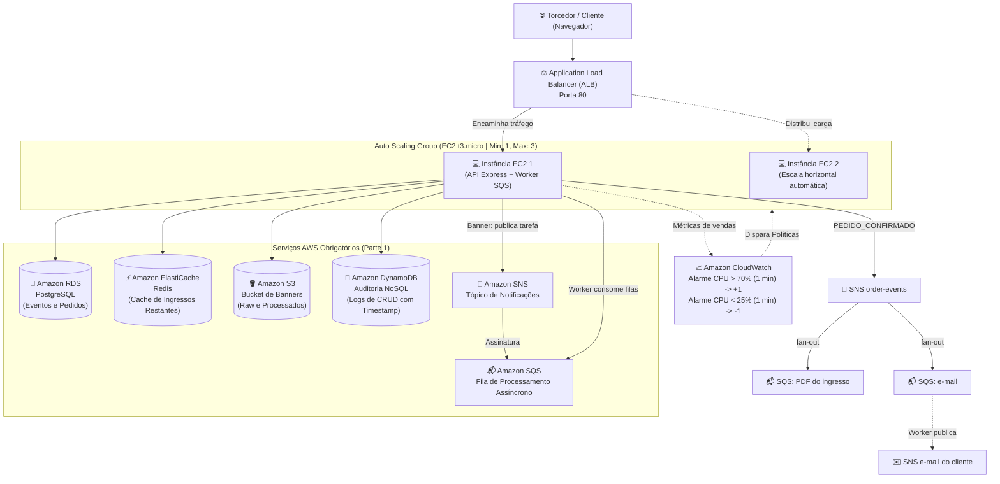

# Loja de Ingressos para Jogos de Futebol - AWS Cloud

Trabalho Prático 1 da disciplina **Desenvolvimento de Software para Nuvem (UFC)**  
**Professores:** Dr. Paulo A. L. Rego e Dr. Fernando Antonio Mota Trinta  

---

## 🎯 Visão Geral

Plataforma de alta disponibilidade e elasticidade na nuvem AWS para venda de ingressos de jogos de futebol, implementando controle atômico de concorrência, camada de cache distribuído em memória, processamento assíncrono de banners e auditoria completa em banco NoSQL.

### Funcionalidades

- **Setores com preço próprio** (Arquibancada Norte e Sul, Cadeira Central, Camarote) escolhidos num **mapa clicável do estádio**.
- **Reserva temporária de 10 minutos** no checkout: os ingressos saem do estoque ao reservar e voltam sozinhos se a compra não for confirmada (cronômetro na tela).
- **Ingresso em PDF com QR code assinado**, gerado em segundo plano e guardado de forma privada no MinIO (a API entrega o arquivo depois de validar o token).
- **E-mail de confirmação** com o link do ingresso, enviado via **Amazon SNS** (o SES é bloqueado no AWS Academy).
- **Meus ingressos**: cada torcedor vê só as próprias compras e baixa os PDFs.
- **Painel admin** (acesso apenas pelo endereço `/admin.html`): CRUD de jogos e setores, pedidos, auditoria e monitor de instâncias.
- **Elasticidade demonstrável**: teste de carga com **k6** (relatório com gráficos) e **dashboard do CloudWatch** com CPU, instâncias, requisições, filas e vendas.

---

## 🏛️ Arquitetura na Nuvem AWS

A infraestrutura foi desenhada e provisionada em conformidade com as **duas partes** solicitadas na especificação do trabalho:



---

## 📋 Conformidade com os Requisitos do Trabalho

| Requisito do Trabalho | Serviço AWS Utilizado | Como foi implementado |
| :--- | :--- | :--- |
| **1. Execução na EC2** | Amazon EC2 | Aplicação Node.js rodando em instâncias EC2 (`t3.micro`) configuradas via `systemd` e `user_data`. |
| **2. Banco Relacional** | Amazon RDS (PostgreSQL) | Fonte única de verdade para eventos, pedidos **e usuários** (compartilhados por todas as instâncias do ASG). Compra com `UPDATE ... WHERE available >= n` transacional: nunca vende mais que o estoque. Se o RDS falhar a API retorna erro (sem fallback para arquivo local). |
| **3. Arquivo Binário** | Amazon S3 | Armazenamento dos banners (`banners/raw/`) e thumbnails (`banners/processed/`). Só aceita imagens (JPEG/PNG/WEBP/GIF); leitura pública via bucket policy (sem ACL). O Terraform cria o bucket. |
| **4. Cache em Memória** | Amazon ElastiCache (Redis) | Cache acelerador de alta frequência para a listagem de jogos e estoque disponível (`events:list`), invalidado a cada nova compra. |
| **5. Auditoria NoSQL** | Amazon DynamoDB | Registro de todas as operações de CRUD (`CREATE`, `READ`, `UPDATE`, `DELETE`, `ORDER`, `RESCALE_BANNER_*`) com tipo de ação, dados manipulados e timestamp. Um índice (`by-time`) lista os registros mais recentes em ordem. |
| **6. Desacoplamento Assíncrono** | Amazon SNS / SQS | (a) **Banner**: a API grava a imagem no S3, publica no SNS (entregue ao SQS) e responde na hora; o **Worker** redimensiona com `sharp`. (b) **Compra**: a API publica um único evento `PEDIDO_CONFIRMADO` no SNS, que faz **fan-out** para duas filas SQS independentes — uma gera o **PDF com QR code** (S3 privado) e a outra envia o **e-mail** ao cliente (SNS e-mail). Cada fila tem **DLQ**. |
| **Parte 2: Elasticidade Horizontal** | ALB + Auto Scaling Group + CloudWatch | Balanceador de carga à frente de 1 a 3 instâncias com regras de escalabilidade por CPU (>70% escala +1, <25% escala -1 por mais de 1 minuto). **Dashboard do CloudWatch** com CPU, instâncias, requisições, filas e métricas de vendas; carga gerada com **k6** (`loadtest/`). |

---

## 📂 Estrutura do Repositório

```text
├── backend/
│   ├── server.js            # Ponto de entrada: sobe o Express (src/app.js) e inicializa RDS/Redis
│   ├── worker.js            # Worker desacoplado: consome a fila, redimensiona imagens (sharp)
│   ├── schema.sql           # Esquema relacional (RDS PostgreSQL) - fonte única
│   ├── test-api.test.js     # Testes automatizados da API e do Worker (Node test runner)
│   ├── package.json         # Dependências (Express, pg, redis, sharp, AWS SDK v3)
│   └── src/                 # Arquitetura MVC, um módulo (pasta) por CRUD
│       ├── app.js           # Monta o Express: middlewares + rotas de cada módulo
│       ├── bootstrap.js     # Inicialização (schema do RDS, Redis)
│       ├── config/          # Variáveis de ambiente e caminhos
│       ├── lib/             # Infra compartilhada: db (RDS), cache (Redis), storage (MinIO), queue (RabbitMQ)
│       ├── middlewares/     # auth (JWT/admin), upload (multer), errorHandler
│       └── modules/
│           ├── events/      # CRUD de jogos: model, controller, routes, validation
│           ├── orders/      # Compra (estoque atômico), listagem (admin) e "meus ingressos": model, controller, routes
│           ├── users/       # Cadastro e login de clientes: model, controller, routes, password
│           ├── auth/        # Login do administrador
│           ├── audit/       # Auditoria no DynamoDB: model, controller, routes
│           └── system/      # /health (ALB) e /stress (teste de elasticidade)
├── frontend/
│   ├── index.html           # Vitrine, login e checkout
│   ├── meus-ingressos.html / .js # Tela "Meus ingressos": pedidos do usuário logado
│   ├── admin.html / admin.js # Painel admin: CRUD, pedidos, auditoria, monitor AWS e teste de carga
│   ├── app.js               # Integração assíncrona da vitrine/checkout
│   └── styles.css           # Estilização moderna e responsiva
├── infra/
│   ├── main.tf              # Provisionamento completo em Terraform (ALB, ASG, RDS, Cache, S3, DynamoDB, SNS/SQS + DLQ)
│   ├── variables.tf         # Declaração de variáveis
│   ├── outputs.tf           # Saídas da infraestrutura (URL do ALB, endpoints dos bancos)
│   ├── user_data.sh.tpl     # Script de bootstrap automatizado para a EC2
│   ├── terraform.tfvars.example # Exemplo de configuração
│   └── README.md            # Documentação da infraestrutura e roteiro de gravação do vídeo
├── loadtest/
│   ├── k6-elasticidade.js   # Teste de carga da Parte 2 (k6), com relatório HTML
│   └── README.md            # Como rodar o k6 e o que mostrar no vídeo
├── docker-compose.yml       # Ambiente local com PostgreSQL e Redis para testes
└── README.md                # Este documento
```

### Padrão MVC por módulo

Cada recurso fica em sua pasta em `backend/src/modules/<recurso>/` com:

| Camada | Arquivo | Responsabilidade |
| :--- | :--- | :--- |
| **Model** | `*.model.js` | Acesso a dados (RDS ou store local em dev). Sem conhecer HTTP. |
| **Controller** | `*.controller.js` | Valida a entrada e orquestra model + MinIO + cache + auditoria + fila; monta a resposta. |
| **Routes** | `*.routes.js` | Liga URL/verbo HTTP aos controllers e aplica os middlewares (admin, usuário, upload). |
| **View** | `frontend/` | Interface web que consome a API JSON. |

Para criar um novo CRUD, crie a pasta do módulo e registre suas rotas em `src/app.js`.

---

## 🐳 Executar com Docker Compose (Trabalho 2)

Sobe tudo com um único comando: **PostgreSQL** (substitui o RDS) **RabbitMQ** (substitui SNS/SQS) e **MinIO** (substitui o S3), todos gerenciados por nós, mais Redis, backend (API), worker e frontend (nginx).
Requer Docker com o comando `docker compose` e suporte à opção `--wait`.

```bash
git clone https://github.com/luiscarlo5/Plataforma-Ingresso.git
cd Plataforma-Ingresso
cp .env.example .env          # troque as senhas e o JWT_SECRET
docker compose up --build -d --wait
docker compose ps
```

Acesse **http://localhost:8080** (loja) e **http://localhost:8080/admin** (painel, senha = `ADMIN_PASSWORD`).

| Serviço | Imagem | Rede | Observação |
|---|---|---|---|
| `postgres` | `postgres:16-alpine` | `backend-net` | volume `pgdata`; **sem porta publicada** no host |
| `minio` | `chainguard/minio` | `backend-net`, `frontend-net` | volume `miniodata`; bucket `stadium-files` criado pela API no boot; console em http://localhost:9001 (usuário/senha do `.env`). O `minio/minio` saiu do Docker Hub, por isso a imagem da Chainguard |
| `rabbitmq` | `rabbitmq:3.13-management-alpine` | `backend-net` | volume `rabbitmqdata`; painel de gestão em http://localhost:15672 (usuário/senha do `.env`) |
| `redis` | `redis:7-alpine` | `backend-net` | cache opcional |
| `backend` | `backend/Dockerfile` | `backend-net`, `frontend-net` | espera Postgres, RabbitMQ, MinIO e Redis saudáveis; cria o esquema (`schema.sql`) e os jogos iniciais no 1º boot |
| `worker` | mesma imagem do backend (`node worker.js`) | `backend-net` | consome as filas do RabbitMQ (PDF, e-mail, banner); espera Postgres, RabbitMQ, MinIO e backend saudáveis |
| `frontend` | `frontend/Dockerfile` (nginx) | `frontend-net` | serve o site e repassa a API para o `backend`; única porta publicada: 8080 |

Comandos úteis:
```bash
docker compose logs -f backend worker                                  # logs
docker compose exec postgres sh -c 'psql -U $POSTGRES_USER -d $POSTGRES_DB -c "select * from orders;"'
docker compose down        # para os serviços, mantém os dados (volume pgdata)
docker compose down -v     # para e APAGA os dados
```

Para rodar a API/testes fora do Docker com Postgres e Redis em containers:
`docker compose -f docker-compose.yml -f docker-compose.dev.yml up -d postgres redis rabbitmq minio` (publica 5432/6379/5672/9000 só em 127.0.0.1).

**Filas (RabbitMQ):** a compra publica `PEDIDO_CONFIRMADO` no exchange fanout `order.events`, que entrega a mesma mensagem às filas `tickets.tasks` (PDF) e `notifications.tasks` (e-mail); `banner.tasks` redimensiona banners. Cada fila tem uma DLQ (`*.dlq`) para mensagens ilegíveis ou rejeitadas. Se o RabbitMQ cair e voltar, o worker se reinscreve sozinho.

**Arquivos (MinIO):** um bucket com dois prefixos. `banners/*` (original e miniatura) tem leitura anônima e o nginx o expõe em `/files/banners/` (só `GET`). `tickets/*` (PDF do ingresso) é privado: só a API lê do MinIO e entrega o PDF depois de validar o token do dono. O código usa o `@aws-sdk/client-s3` com `endpoint` e `forcePathStyle`, porque o MinIO fala o protocolo S3.

### DynamoDB gerenciado pela AWS (auditoria do Trabalho 2)

Para a entrega, habilite o DynamoDB real da AWS. No `.env` da raiz, mantenha as variáveis do Compose e acrescente ou atualize as configurações abaixo:

```dotenv
AWS_REGION=us-east-1
DYNAMODB_TABLE_NAME=stadium-tickets-audit-logs
DYNAMODB_REQUIRED=true
AWS_ACCESS_KEY_ID=
AWS_SECRET_ACCESS_KEY=
AWS_SESSION_TOKEN=
```

Use a região e as três credenciais temporárias mostradas no Learner Lab. O `.env` fica fora do Git. Proteja o arquivo com `chmod 600 .env`. Quando a sessão expirar, renove as credenciais no arquivo e recrie os containers. Na EC2, se a instância já tiver uma role com as permissões, deixe as três variáveis de credenciais ausentes.

```bash
docker compose build backend worker
docker compose run --rm --no-deps backend npm run dynamodb:setup
docker compose up --build -d --wait
docker compose exec -T backend npm run dynamodb:verify
```

- O setup valida uma tabela existente ou cria uma com cobrança sob demanda, chave `id` e índice `by-time` (`pk`, `timestamp`). Requer `dynamodb:DescribeTable` e, se a tabela ainda não existir, `dynamodb:CreateTable`. Se o laboratório restringir a criação, use uma tabela compatível já provisionada na mesma conta e região.
- Durante a execução a API e o worker precisam de `dynamodb:PutItem` na tabela e `dynamodb:Query` no índice. A verificação também precisa de `dynamodb:GetItem` na tabela. O Compose injeta as configurações nos dois containers a partir do `.env`.
- A verificação cria um jogo temporário por meio da API, busca o registro `CREATE` pela mesma rota usada no painel e compara o resultado com uma leitura direta pela chave no DynamoDB. Ao final, remove o jogo e preserva seus registros de auditoria. Guarde a saída com os IDs do jogo e da auditoria. Para conferir visualmente, abra **Admin → Auditoria** e procure o mesmo ID no payload. No console AWS, confira o item usando o ID de auditoria.
- Com `DYNAMODB_REQUIRED=true`, a API exige uma consulta bem-sucedida ao índice na inicialização. O campo `auditStorage` de `/health` informa o modo e o resultado da última consulta. Se uma consulta da auditoria falhar, o painel recebe HTTP 503 e o backend registra o erro. Para desenvolvimento offline, deixe `DYNAMODB_REQUIRED=false` e `DYNAMODB_TABLE_NAME` vazia para usar memória.

### Evidências de funcionamento — 20/11/2026

A validação acompanhou um único evento, `match-1795216263818-0912f4`, do upload do banner até a emissão do ingresso. O pedido correspondente foi `order-6968f120-71a9-460a-a1d1-1267121dfe1c`. Esses identificadores pertencem à execução local da equipe. Em uma instalação nova, use os identificadores gerados ao repetir o fluxo.

| Verificação | Resultado observado |
|---|---|
| Inicialização pelo Compose | Sete serviços em execução. PostgreSQL, Redis, RabbitMQ, MinIO e backend passaram nos healthchecks. A loja respondeu com HTTP 200 e a API listou quatro eventos antes do cadastro de teste. |
| Cadastro e banner | A API respondeu com HTTP 201 e confirmou o envio para `banner.tasks`. O processamento passou de `pending` para `completed`. O PNG baixado pela rota pública era idêntico ao original de 800 × 520 pixels. A miniatura JPEG tinha 400 × 260 pixels. |
| Compra e persistência | Um ingresso de R$ 50,00 na Arquibancada Norte reduziu o estoque de 35 para 34. A consulta ao PostgreSQL retornou quantidade `1`, total `50.00`, status `confirmed` e ingresso `ready`. |
| Mensageria e download | O log do worker registrou o mesmo pedido nas tarefas de PDF e de notificação, ambas na primeira tentativa. Pela API de **Meus ingressos**, o comprador baixou um PDF de 9.984 bytes. O texto do documento continha o identificador do pedido. |
| Suíte de integração | 21 testes passaram, sem falhas ou testes pulados, em um projeto Compose isolado com PostgreSQL, RabbitMQ e MinIO. |
| Auditoria | A API retornou a ação `CREATE` para o evento. Nessa execução, `/health` indicou `dynamodb: false` e a auditoria usou memória. A validação na AWS continua pendente. |

Para repetir, cadastre um evento com banner no painel, compre um ingresso na loja e baixe o PDF em **Meus ingressos**. Use o ID da compra para localizar as duas tarefas no histórico do worker e consultar o registro persistido:

```bash
pedido='order-6968f120-71a9-460a-a1d1-1267121dfe1c'  # substitua pelo ID da sua compra
docker compose logs worker | grep -F -- "$pedido"
docker compose exec -T postgres sh -c 'psql -U "$POSTGRES_USER" -d "$POSTGRES_DB" -v pedido="$1"' sh "$pedido" <<'SQL'
SELECT id, quantity, total, status, ticket_status FROM orders WHERE id = :'pedido';
SQL
```

Para registrar a evidência do NoSQL na AWS, execute `npm run dynamodb:verify` conforme a seção acima e guarde a saída com o ID do registro.

---

## 💻 Como Executar Localmente

### 1. Iniciar Banco e Cache Locais (Opcional)
O **PostgreSQL, o RabbitMQ e o MinIO são obrigatórios**: sem `DATABASE_URL`, `RABBITMQ_URL` e `MINIO_*` a API e o worker recusam subir (não existe mais modo em arquivo). Para rodar fora do Docker, use PostgreSQL, RabbitMQ, MinIO e Redis em containers:
```bash
docker compose -f docker-compose.yml -f docker-compose.dev.yml up -d postgres redis rabbitmq minio   # exige o .env da raiz
cd backend && cp .env.example .env   # DATABASE_URL: use a senha definida no .env da raiz
export $(grep -v '^#' .env | xargs)  # ou: node --env-file=.env server.js
```

### 2. Rodar a API e o Worker
```bash
cd backend
npm install

# Em um terminal, inicie a API:
npm start

# Em outro terminal, inicie o Worker desacoplado de fila:
npm run worker
```

Acesse a interface no navegador em: `http://localhost:3000`

### 3. Rodar os Testes Automatizados
```bash
cd backend
npm test
```
*Executa 21 testes de integração da API e três testes com o cliente DynamoDB simulado. A suíte de integração exige PostgreSQL, RabbitMQ e MinIO reais (`DATABASE_URL`, `RABBITMQ_URL`, `MINIO_ENDPOINT`, `MINIO_ACCESS_KEY`, `MINIO_SECRET_KEY`). Execute a suíte em uma pilha de teste, com auditoria em memória e sem outro consumidor nas filas para que o próprio teste processe as mensagens. Para provar a integração no DynamoDB gerenciado, use `dynamodb:verify`.*

---

## ☁️ Como Fazer o Deploy na AWS (Terraform)

Para subir a infraestrutura completa na nuvem e obter a URL do Application Load Balancer:

```bash
cd infra
cp terraform.tfvars.example terraform.tfvars   # preencha db_password, admin_password e repo_url
terraform init
terraform plan
terraform apply -auto-approve
```

O Terraform imprimirá a URL pública da aplicação:
```bash
application_url = "http://stadium-tickets-alb-XXXXX.us-east-1.elb.amazonaws.com"
```

> **AWS Academy:** o `apply` usa a `LabRole` (instance profile `LabInstanceProfile`). Se a política da conta bloquear a leitura do bucket S3 pelo Terraform, crie o bucket pelo AWS CLI e use `create_banners_bucket = false` (passo a passo em [infra/README.md](infra/README.md)). A instância leva de 2 a 8 minutos após o `apply` para responder (até lá o ALB devolve 502).

### Atualizar a aplicação depois de uma mudança no código

As instâncias baixam o código do GitHub ao nascer. Depois de `git push origin main`, troque a instância para ela pegar a versão nova (o `start-instance-refresh` é bloqueado no AWS Academy):

```bash
aws autoscaling terminate-instance-in-auto-scaling-group --no-should-decrement-desired-capacity \
  --instance-id $(aws autoscaling describe-auto-scaling-groups --query 'AutoScalingGroups[0].Instances[0].InstanceId' --output text)
```

Mudanças em `infra/` (ou em variáveis como senhas) exigem `terraform apply` antes da troca.

---

## 🔗 Como acessar (depois do deploy)

Use a `application_url` do `terraform output` (sempre `http://`, sem certificado):

| Página | Endereço | Acesso |
| :--- | :--- | :--- |
| Loja (vitrine, mapa de setores, checkout) | `http://<ALB>/` | Público; comprar exige cadastro/login |
| Meus ingressos (pedidos e PDFs) | `http://<ALB>/meus-ingressos.html` | Torcedor logado |
| Painel administrativo | `http://<ALB>/admin.html` | Senha `admin_password` do `terraform.tfvars`. **Não há link na loja**: o acesso é só pelo endereço |
| Status dos serviços | `http://<ALB>/health` | Público (usado pelo health check do ALB) |
| Dashboard do CloudWatch | `terraform output cloudwatch_dashboard_url` | Console da AWS (ver abaixo) |

**Dashboard e console da AWS:** os links do console exigem estar logado na conta. No AWS Academy, abra o console pelo botão **AWS** do Learner Lab (com a sessão ativa) e só então abra o link do dashboard, ou navegue por *CloudWatch → Dashboards → stadium-tickets-elasticidade*.

**E-mails de confirmação de compra:** o SES é bloqueado no AWS Academy, então os e-mails saem pelo **Amazon SNS**. Ao se cadastrar, o torcedor recebe um e-mail **"AWS Notification - Subscription Confirmation"** e precisa clicar em **Confirm subscription** uma única vez (veja também o spam). A partir daí, cada compra chega por e-mail com o link do PDF do ingresso. Contas antigas podem ativar em *Meus ingressos → Ativar e-mails*.

**Senha do admin:** troque o valor de exemplo de `admin_password` no `terraform.tfvars` antes de publicar (ele é público no `terraform.tfvars.example`), rode `terraform apply` e troque a instância.

**Ao terminar:** `terraform destroy` (e, se o bucket foi criado pelo CLI, `aws s3 rb s3://<bucket> --force`). RDS, ALB e ElastiCache são cobrados por hora.

### Documentos de apoio

- [loadtest/README.md](loadtest/README.md): teste de carga com k6.

---

